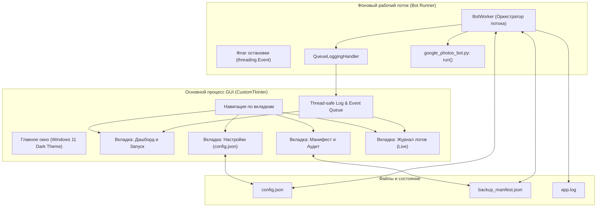

# План разработки нативного Windows GUI (CustomTkinter)

> **Цель проекта:** Создать современное, отзывчивое десктопное приложение для Windows 10/11 на базе `customtkinter`, которое избавит от необходимости редактировать `config.json` в Блокноте, обеспечит безопасный запуск бота в фоновом потоке без зависаний интерфейса, визуализирует процесс синхронизации, состояние манифеста и журнал логов в реальном времени.

---

## Архитектура системы

---

## Этапы разработки

### Этап 1: UX/UI Проектирование и дизайн-система
- [ ] Определение цветовой палитры Windows 11 (темная тема по умолчанию, поддержка светлой).
- [ ] Компоновка 4 ключевых вкладок:
  1. **«Дашборд»:** статус сессии, карточки метрик (объем, файлы, удалено), прогресс текущего блока, кнопки «Старт», «Пауза/Стоп».
  2. **«Настройки»:** системный выбор папок (`Обзор...`), ползунки, валидация полей, бейджи безопасности для `DRY_RUN_DELETE`.
  3. **«Манифест»:** просмотр сводной статистики, фильтр по датам, запуск аудита целостности из `manifest_report.py`.
  4. **«Журнал»:** живой лог с цветовой подсветкой (зеленый/желтый/красный) и фильтрацией по уровням.
- [ ] Модальные окна подтверждения для деструктивных действий (удаление из облака, очистка манифеста).

### Этап 2: Потокобезопасный мост и воркер (Runner & Logging Bridge)
- [ ] Разработка модуля `gui/runner.py`:
  - Класс `BotRunner(threading.Thread)` для изолированного запуска без блокировки интерфейса Playwright-циклом.
  - Потокобезопасная передача сообщений в UI через `queue.Queue`.
  - Поддержка мягкой остановки (`stop_requested`).
- [ ] Кастомный `QueueLogHandler` для перехвата сообщений из `logging` и трансляции в очередь UI.

### Этап 3: Реализация компонентов GUI (`gui/`)
- [ ] Добавление зависимости `customtkinter>=5.2.0` в `requirements.txt`.
- [ ] Реализация модульной структуры:
  - `gui/app.py` — главное окно, навигация, переключение тем.
  - `gui/views/dashboard_view.py` — витрина метрик, прогресс, запуск.
  - `gui/views/settings_view.py` — форма конфигурации с нативным диалогом выбора папок.
  - `gui/views/manifest_view.py` — интеграция отчетов и аналитики.
  - `gui/views/logs_view.py` — терминал логов с автоскроллом.

### Этап 4: Интеграция с лаунчером и проектом
- [ ] Создание точки входа `gui_app.py`.
- [ ] Модификация `start_bot.bat`:
  - Меню выбора режима: **1. Запуск с графическим интерфейсом (GUI)**, **2. Консольный режим (CLI)**.
  - Автоматическая установка `customtkinter` при первом старте.

### Этап 5: Автоматизированное тестирование и верификация
- [ ] Unit-тесты для `BotRunner` (запуск, остановка, передача логов в очередь).
- [ ] Тесты сохранения и валидации `config.json` через настройки GUI.
- [ ] Проверка запуска под Windows 10/11 и отсутствия утечек памяти.

### Этап 6: Обновление документации
- [ ] Обновление `README.md` со скриншотами и описанием работы с GUI.
- [ ] Добавление страницы `wiki/gui.md` в базу знаний проекта.

---

> [!NOTE]
> В процессе выполнения бот **всегда запускается в headful-режиме Chromium** (`HEADLESS_MODE=false`), окно Google Photos аккуратно сосуществует рядом с окном GUI, сохраняя полную работоспособность React Virtual DOM и шортката `Shift+D`.
