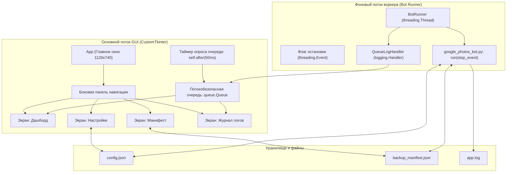

# Графический интерфейс (CustomTkinter GUI)

> Нативное десктопное Windows 10/11 приложение для визуального контроля, настройки и запуска Google Photos Backup & Sync Bot.

---

## Архитектура GUI

Приложение построено на базе библиотеки `customtkinter` с соблюдением требований Fluent Design Windows 11 и полной потокобезопасности при работе с фоновым браузерным циклом Playwright:



---

## Ключевые компоненты

### 1. `gui/runner.py`
- **`QueueLogHandler(logging.Handler)`**: Перехватывает записи из стандартного Python `logging` и транслирует их в потокобезопасную очередь `queue.Queue` в виде структурированных словарей `{"type": "log", "level": str, "message": str, "created": float}`.
- **`BotRunner(threading.Thread)`**: Оркестратор фонового выполнения бота. Гарантирует, что браузерная автоматизация Playwright работает в отдельном потоке и никогда не блокирует отрисовку интерфейса. Управляет мягкой остановкой через `stop_event` и сообщает UI о смене состояний (`running`, `stopping`, `stopped`, `finished`, `error`).

### 2. `gui/config_manager.py`
- Модуль валидации и сохранения `config.json`.
- Проверяет корректность типов, обязательность путей, неотрицательность числовых параметров и допустимые диапазоны таймингов.
- Исключает повреждение конфигурационного файла при некорректном вводе.

### 3. `gui/views/dashboard_view.py` (Дашборд)
- **KPI-карточки метрик:**
  - 📁 *Файлов в архиве* — количество верифицированных файлов из манифеста.
  - 💾 *Общий объем* — суммарный размер архива в удобном формате (МБ, ГБ).
  - 📥 *Скачано за сеанс* — счетчик новых медиафайлов текущей сессии.
  - 🗑️ *Удалено из облака* — счетчик удаленных файлов текущей сессии.
- **Индикатор статуса:** Отображает текущее состояние («Готов к работе», «Синхронизация выполняется...», «Остановка...», «Завершено», «Ошибка»).
- **Бейдж безопасности:** Наглядно показывает статус `DRY RUN (Безопасно)` или предупреждение `ВНИМАНИЕ: РЕАЛЬНОЕ УДАЛЕНИЕ`.
- **Прогресс-бар и действие:** Отображает выполняемую операцию (инициализация, скачивание архива, удаление, скролл).
- **Кнопки управления:** «▶ Запустить синхронизацию», «🛑 Остановить», «🔄 Обновить метрики».
- **Быстрый лог:** Компактная live-лента последних событий.

### 4. `gui/views/settings_view.py` (Настройки)
- **Выбор папки через проводник:** Кнопка «Обзор...» вызывает системный диалог проводника Windows (`filedialog.askdirectory`).
- **Слайдер периода хранения:** Наглядный ползунок `DAYS_TO_KEEP_IN_CLOUD` с динамическим расчетом даты («Фотографии старше этой даты подлежат удалению: ДД.ММ.ГГГГ»).
- **Переключатели безопасности:**
  - `DRY_RUN_DELETE` и `ALLOW_CLOUD_DELETE` снабжены адаптивным бейджем.
  - При попытке отключить безопасный режим выводится модальное окно с предупреждением и запросом подтверждения.
- **Параметры выполнения:** `STOP_AT_DATE`, `MAX_DELETE_BLOCKS_PER_RUN`, `LOG_LEVEL` (WARNING/INFO/DEBUG), `HEADLESS_MODE`.
- **Расширенные настройки таймингов:** Шаг и пауза скролла, таймауты скачивания и 2FA.
- **Действия:** «💾 Сохранить настройки», «🔄 Сбросить к сохраненным», «Сброс к умолчанию», «📄 Открыть config.json».

### 5. `gui/views/manifest_view.py` (Манифест и аудит)
- **Сводные показатели:** Блоки всего, подтверждено, удалено из облака, кандидаты на удаление, ошибки.
- **Экспресс-аудит целостности:** Запуск встроенного аудита на основе `manifest_report.py` с детальным анализом покрытия дат и защитой от случайного удаления.
- **Поиск и фильтры:** Поиск по фрагменту даты или тексту; фильтрация по статусам (Все, Подтвержденные, Удаленные, Кандидаты, С ошибками, Неподтвержденные).
- **Интерактивный список:** Таблица блоков с возможностью открыть карточку «Инфо» (список файлов в блоке, их размеры и SHA-256 хеши).
- **Быстрый доступ:** Открытие папки архива на диске или файла `backup_manifest.json`.

### 6. `gui/views/logs_view.py` (Журнал логов)
- **Цветовая подсветка уровней:**
  - Красный — `ERROR` / `CRITICAL`
  - Желтый/Оранжевый — `WARNING`
  - Зеленый — `INFO`
  - Бирюзовый — `RUN`
  - Серый — `DEBUG`
- **Инструменты контроля:**
  - Сегментированный фильтр уровней (`Все`, `RUN / INFO`, `WARNING`, `ERROR`).
  - Поиск по тексту в реальном времени.
  - Переключатель автопрокрутки.
  - Кнопки: «📋 Копировать», «📂 Открыть app.log», «🗑️ Очистить».
- **Автозагрузка истории:** При открытии автоматически подгружает хвост последних событий из `app.log`.

---

## Способы запуска

### 1. Через командный файл `start_bot.bat` (Рекомендуется)
При запуске `start_bot.bat` пользователю предлагается выбор:
```text
========================================
Select launch mode:
  [1] Graphical Interface (GUI) - Recommended
  [2] Console Mode (CLI)
========================================
Choose mode [1/2] (Default in 10s is GUI: 1):
```
- Если не нажимать клавиши, через 10 секунд автоматически стартует GUI.
- При первом запуске скрипт автоматически устанавливает зависимости из `requirements.txt` (включая `customtkinter`).

### 2. Напрямую из виртуального окружения
```powershell
venv\Scripts\python.exe gui_app.py
```

---

## Безопасность и отказоустойчивость

1. **Защита от зависания интерфейса:** Playwright и браузерный движок изолированы в фоновом потоке. Главный цикл CustomTkinter никогда не блокируется операциями ввода-вывода или сетевыми задержками.
2. **Мягкая остановка:** При нажатии кнопки «🛑 Остановить» бот корректно завершает обработку текущего блока и безопасно закрывает браузер, сохраняя целостность манифеста.
3. **Предотвращение потери данных:** Реальное удаление из Google Photos возможно только при одновременном снятии флага `DRY_RUN_DELETE` и подтверждении в системном модальном окне.
